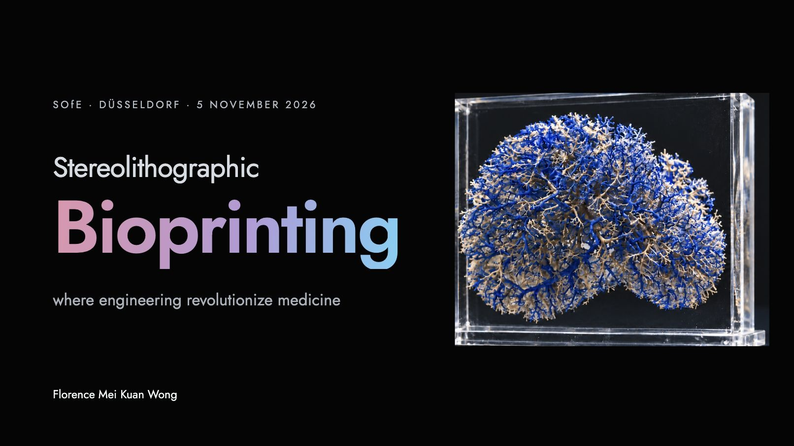

# 3D Bioprinting

**where engineering revolutionize medicine**

Florence Mei Kuan Wong · SOfE Düsseldorf · 5 November 2026



## View the slides

Open [the presentation](presentation/index.html) in a browser. You can also download the HTML file and open it offline; fonts, figures and two videos are included. No installation is required. Slide 2 contains the tram story. Slide 7 includes the interactive bioprinting map, with its data and Natural Earth country boundaries embedded in the same HTML file.

The deck contains **51 slides**:

| Slides | Content |
| --- | --- |
| 1–23 | Main talk |
| 24–28 | References and image credits |
| 29–51 | Technical backup |

[Transcript and speaker notes](presentation/transcript.md)

## Controls

| Key | Action |
| --- | --- |
| Arrow keys / Space / Page Up / Page Down | Navigate |
| O | Slide overview |
| N | Speaker notes |
| F | Fullscreen |
| Home / End | First / last slide |
| Esc | Close panels |
| E | Edit slide text; changes save in your browser |
| Ctrl/Cmd + S | Download an HTML copy with your edits |

Horizontal swipes and the mouse wheel also navigate. Link to a specific slide with a hash, such as `presentation/index.html#7`. Text inside figure images is not editable; browser edits do not update the transcript.

Every slide has content-aware entrance animations and a gentle 620 ms transition.
Comparisons reveal in reading order; technical figures stay aligned as they fade
in. Slide advancement remains presenter controlled. Reduced-motion preferences
are respected. [Animation maintenance and timing](tools/MOTION.md).

## Data and sources

- **[Worldwide bioprinting geography through 2025](data/geography-2025/):** Excel workbook and CSV files with top-20 country rankings, full author/affiliation tables, institutional coordinates, and a sourced company register with historical and unconfirmed status flags.
- **[Publication trends · slide 8](data/publication-trends/):** Scopus (Elsevier) counts for 2000–2026, with a roughly six-second continuous left-to-right reveal. 2026 is partial as of 27 October 2026; [CSV and methods](data/publication-trends/scopus/).
- **[Organ-transplant timeline](data/organ-transplants/):** reported2015–2025 activity;2025 six-organ total183,879 and49,169 deceased donors. Right callouts sum reported2025 organ-list entries:532,905 waiting;40,019 deaths. Source: archived EDQM–ONT Newsletter Transplant2026. No2026forecast.

The publication chart reveals automatically without buttons inside the chart; the bottom toolbar provides Replay and arrows for year selection. On this chart, Left/Right select years, R replays, and Page Up/Down or Space navigate slides. The organ chart has playback controls. Their data directories include raw values, sources and coverage limitations.

Slide images, SVG artwork, both videos, and fonts are also available separately
in [materials/](materials/), with a slide-to-file inventory and SHA-256 hashes.
Repository maintenance rules are in [AGENTS.md](AGENTS.md).

Available full-text papers, cited books/chapters, and supporting reading are
stored in [papers/](papers/), with a DOI/file inventory and an explicit list of
references whose full texts are still missing.

## Maintain the presentation

The self-contained deck is in `presentation/index.html`; theme, controller and conversion scripts are in `tools/`. The original PowerPoint is kept outside this repository. The presenter introduction is slide 1, before the cover on slide 2. It starts with the name/photo and reveals the three points one per click. [Editing guide](EDITING.md); [opening-slide settings](presentation/settings.json).

After changing chart data, run the corresponding updater from the repository root:

```sh
python3 tools/update_publication_slide.py
python3 tools/update_organ_slide.py
```

Each updater preserves the other 50 slide sections. Check the data with `tools/check_publication_data.py` and `tools/check_organ_data.py`. Full conversion requires Python with `python-pptx`, Pillow and PyMuPDF, plus LibreOffice; see `tools/render_source.py` and `tools/build_deck.py` for their command-line arguments.

## Credits

Scientific sources and image credits are retained in the deck and transcript. Third-party figures, photographs and videos retain their respective rights. Jost is bundled under the [SIL Open Font License](presentation/Jost-OFL.txt).
