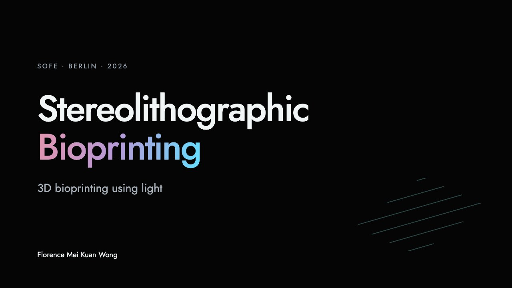

# Stereolithographic Bioprinting

**3D bioprinting using light**

Florence Mei Kuan Wong · SOFE Berlin · 15 October 2026



## View the slides

Open [the presentation](presentation/index.html) in a browser. You can also download the HTML file and open it offline; fonts, figures and two videos are included. No installation is required.

The deck contains **50 slides**:

| Slides | Content |
| --- | --- |
| 1–22 | Main talk |
| 23–27 | References and image credits |
| 28–50 | Technical backup |

[Transcript and speaker notes](presentation/transcript.md)

## Controls

| Key | Action |
| --- | --- |
| Arrow keys / Space / Page Up / Page Down | Navigate |
| O | Slide overview |
| N | Speaker notes |
| F | Fullscreen |
| Home / End | First / last slide |
| Esc | Close panels |
| E | Edit slide text; changes save in your browser |
| Ctrl/Cmd + S | Download an HTML copy with your edits |

Horizontal swipes and the mouse wheel also navigate. Link to a specific slide with a hash, such as `presentation/index.html#7`. Text inside figure images is not editable; browser edits do not update the transcript.

## Data and sources

- **[Worldwide bioprinting geography through 2025](data/geography-2025/):** Excel workbook and CSV files with top-20 country rankings, full author/affiliation tables, institutional coordinates, and a sourced company register with historical and unconfirmed status flags.
- **[Publication trends · slide 7](data/publication-trends/):** Scopus (Elsevier) counts for 2000–2026, with a roughly five-second year-by-year animation. 2026 is partial as of 27 October 2026; [CSV and methods](data/publication-trends/scopus/).
- **[Organ-transplant timeline · slide 8](data/organ-transplants/):** annual-report snapshots for 2015–2024 and separately flagged 2025 homepage highlights. The 2025 transplant figure is a lower bound; kidney waiting-list figures are from 2024.

Both charts have playback controls and year selection. Their data directories include raw values, sources and coverage limitations.

Slide images, SVG artwork, both videos, and fonts are also available separately
in [materials/](materials/), with a slide-to-file inventory and SHA-256 hashes.
Repository maintenance rules are in [AGENTS.md](AGENTS.md).

Available full-text papers, cited books/chapters, and supporting reading are
stored in [papers/](papers/), with a DOI/file inventory and an explicit list of
references whose full texts are still missing.

## Maintain the presentation

The self-contained deck is in `presentation/index.html`; theme, controller and conversion scripts are in `tools/`. The original PowerPoint is kept outside this repository. Rebuilding the web deck omits the personal introduction.

After changing chart data, run the corresponding updater from the repository root:

```sh
python3 tools/update_publication_slide.py
python3 tools/update_organ_slide.py
```

Each updater preserves the other 49 slide sections. Check the data with `tools/check_publication_data.py` and `tools/check_organ_data.py`. Full conversion requires Python with `python-pptx`, Pillow and PyMuPDF, plus LibreOffice; see `tools/render_source.py` and `tools/build_deck.py` for their command-line arguments.

## Credits

Scientific sources and image credits are retained in the deck and transcript. Third-party figures, photographs and videos retain their respective rights. Jost is bundled under the [SIL Open Font License](presentation/Jost-OFL.txt).
